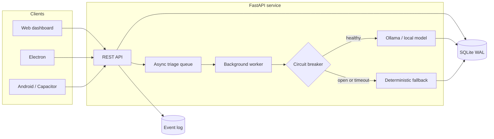

# 🛡️ ResillO

<p align="center">
  <strong>Offline-first emergency field-note triage for unreliable environments</strong>
</p>

<p align="center">
  <a href="#features"></a>
  <a href="#architecture"></a>
  <a href="#features"></a>
  <a href="#native-clients"></a>
</p>

ResillO turns unstructured field reports into actionable triage records for first responders, humanitarian teams, and emergency operators. It is designed for connectivity gaps, local deployments, and abrupt restarts: reports are captured locally, persisted durably, and classified by local AI when available or by a deterministic fallback when it is not.

> **Safety boundary:** ResillO is an operational aid, not a replacement for trained human judgment, established emergency procedures, or verified communications.

## Why ResillO

- **Works through connectivity loss.** The web client stores reports in an IndexedDB outbox and retries them when the API returns.
- **Keeps ingestion responsive.** API writes complete before background triage; Ollama failures do not block report capture.
- **Fails over predictably.** A three-failure circuit breaker routes classification to a local keyword/rule engine.
- **Survives restarts.** SQLite uses WAL mode and `FULL` synchronous writes. Pending notes are re-enqueued when the worker starts.
- **Supports intermittent synchronization.** An append-only event log, idempotency keys, and severity-aware conflict merging protect replayed and out-of-order updates.
- **Runs locally.** The default configuration uses local SQLite and a local Ollama daemon; no cloud AI service is required.

## Features

| Area | Capability |
| --- | --- |
| Field capture | Vue-based responsive dashboard, dark/light theme, report templates, live feed, and manual API-server configuration |
| Triage | Priority (`CRITICAL`, `HIGH`, `MEDIUM`, `LOW`), category, location, summary, and actionable needs |
| Threat monitoring | Five-second refresh cadence, per-note refresh, check counts, and escalation to `WORSENED` |
| Resilience | Ollama circuit breaker, deterministic fallback parsing, background queue, and startup recovery |
| Storage | SQLite database with WAL, `FULL` synchronous mode, indexes, rotating logs, and local token persistence |
| Sync | SHA-256 content keys, idempotent event append, replay protection, and higher-severity conflict preservation |
| Packaging | Browser deployment, Electron desktop shell, and Capacitor Android wrapper |

## Architecture



## Requirements

- Python 3.10+ recommended
- Node.js and npm for Electron/Android tooling
- Android Studio and an Android SDK for native Android builds
- Ollama is optional. Install it only when local LLM triage is desired; fallback triage works without it.

> **Air-gapped UI note:** the current dashboard references Vue and Tailwind through public CDNs. The backend and triage pipeline remain local, but a fully disconnected UI deployment should vendor those browser assets before deployment.

## Quick start

### 1. Install Python dependencies

```bash
git clone https://github.com/coderForLife-A1/ResillO.git
cd ResillO

python -m venv .venv

# Linux/macOS
source .venv/bin/activate

# Windows PowerShell
.\.venv\Scripts\Activate.ps1

pip install -r requirements.txt
```

### 2. Optional: enable local AI triage

Install [Ollama](https://ollama.com), then:

```bash
ollama pull gemma:2b
ollama serve
```

The service defaults to `http://127.0.0.1:11434`. If Ollama is unavailable, ResillO automatically uses deterministic fallback triage.

### 3. Start the API and dashboard

```bash
python -m uvicorn main:app --reload --host 127.0.0.1 --port 8000
```

Open [http://127.0.0.1:8000](http://127.0.0.1:8000).

On first startup, ResillO creates the SQLite database at `data/resillo.sqlite3` and the local API token at `data/resillo.token` unless overridden by configuration.

## Native clients

Install JavaScript dependencies once:

```bash
npm install
```

### Electron desktop

The desktop shell starts the backend, waits for `/api/health`, opens the dashboard, and attempts to restart the backend if it exits unexpectedly.

```bash
npm run desktop
```

To use a specific Python interpreter on Windows:

```powershell
$env:RESILIO_PYTHON = "D:\path\to\.venv\Scripts\python.exe"
npm run desktop
```

`npm run desktop:dev` launches Electron without preparing the copied web asset first.

### Android / Capacitor

```bash
# First-time project creation
npm run android:add

# Copy index.html to www/ and synchronize the native project
npm run android:sync

# Open the project in Android Studio
npm run android:open

# Build/run on a connected device or emulator
npm run android:run
```

Use the dashboard's **API SERVER** button to configure the backend URL:

- Android emulator: `http://10.0.2.2:8000`
- Physical device: `http://<host-LAN-IP>:8000`

The Android application ID is `com.resillo.triage`. The source dashboard is [index.html](index.html); the Capacitor web directory is [www/](www/).

## Configuration

Configuration is read from environment variables. A `.env` file is not loaded automatically.

| Variable | Default | Description |
| --- | --- | --- |
| `RESILIO_HOST` | `127.0.0.1` | API bind address |
| `RESILIO_PORT` | `8000` | API port |
| `RESILIO_DB_PATH` | `data/resillo.sqlite3` | SQLite database path; the token file uses the same path with a `.token` suffix |
| `RESILIO_API_TOKEN` | generated locally | Explicit API token override |
| `OLLAMA_URL` | `http://127.0.0.1:11434` | Ollama endpoint |
| `OLLAMA_MODEL` | `gemma:2b` | Ollama model tag |
| `OLLAMA_CONNECT_TIMEOUT` | `0.5` | Ollama connection timeout in seconds |
| `OLLAMA_READ_TIMEOUT` | `2.0` | Ollama response timeout in seconds |
| `RESILIO_MAX_PAYLOAD` | `65536` | Maximum request content length in bytes |
| `RESILIO_LOG_DIR` | `data/logs` | Rotating log directory |
| `RESILIO_LOG_MAX_BYTES` | `1048576` | Maximum size of each log file |
| `RESILIO_LOG_BACKUP_COUNT` | `5` | Number of rotated log backups |
| `CORS_ORIGINS` | localhost + Capacitor origins | Comma-separated allowed origins |

For protected API calls, send the token as `X-Resillo-Token: <token>` or `Authorization: Bearer <token>`.

## REST API

| Method | Endpoint | Auth | Purpose |
| --- | --- | :---: | --- |
| `GET` | `/` | No | Serve the dashboard |
| `GET` | `/api/health` | No | Return database, queue, and circuit status |
| `GET` | `/api/auth/token` | No | Return the local session token |
| `GET` | `/api/diagnostics` | Yes | Return sanitized operational telemetry |
| `POST` | `/api/notes` | Yes | Persist and enqueue a field note |
| `GET` | `/api/notes` | Yes | List notes, newest first |
| `POST` | `/api/notes/{id}/refresh` | Yes | Re-check a note and update threat state |
| `POST` | `/api/notes/refresh-all` | Yes | Re-check all notes |
| `POST` | `/api/sync` | Yes | Merge event-log updates with idempotency protection |

### Create a note

```bash
curl -X POST http://127.0.0.1:8000/api/notes \
  -H "Content-Type: application/json" \
  -H "X-Resillo-Token: <TOKEN>" \
  -d "{\"raw_text\":\"Bridge collapsed in Sector 4; urgent medical supplies required.\",\"operator_id\":\"RESCUE-07\"}"
```

The initial response is persisted with `triage_status: "pending"`. The background worker updates it to `complete` after Ollama or fallback classification finishes.

### Health and diagnostics

```bash
curl http://127.0.0.1:8000/api/health

# Linux/macOS
TOKEN=$(cat data/resillo.token)
curl -H "X-Resillo-Token: $TOKEN" http://127.0.0.1:8000/api/diagnostics

# Windows PowerShell
$token = Get-Content .\data\resillo.token
Invoke-RestMethod http://127.0.0.1:8000/api/diagnostics -Headers @{"X-Resillo-Token" = $token}
```

Diagnostics contain queue depth, circuit-breaker counters, storage status, conflict counts, and sanitized recent errors. They do not intentionally expose report text or operator identifiers.

## Operations and recovery

### Cold-start verification

Run the five-stage pre-flight check before a field deployment:

```bash
python scripts/verify_cold_start.py
```

It verifies Python imports, SQLite WAL/`FULL` mode and indexes, token persistence, fallback/circuit-breaker readiness, and synchronization between [index.html](index.html) and [www/index.html](www/index.html).

### Daily dogfood audit

With the API running:

```bash
python scripts/dogfood_check.py
```

PowerShell:

```powershell
python .\scripts\dogfood_check.py
```

The audit checks protected diagnostics, database integrity, bounded rotating logs, and queue drain. It exits `0` only when it prints:

```text
PASS dogfood_check: all checks passed
```

Useful options include `--url`, `--token`, `--timeout`, `--drain-timeout`, and `--poll-interval`.

### Failure behavior

- **Ollama unavailable or slow:** after three failures, the circuit opens and fallback classification continues locally.
- **Process restart:** pending notes are loaded into the worker queue during startup.
- **Database full/read-only/locked:** the API returns a structured recoverable storage error (`507` for disk full; `503` for other storage failures). The browser outbox keeps unsent reports.
- **Connectivity loss:** reports remain in IndexedDB and are retried on the next successful sync.
- **Abrupt power loss:** restart the service; SQLite replays WAL frames during recovery.

Do not delete `data/resillo.sqlite3`, its WAL/SHM files, or `data/resillo.token` while the service is running. Preserve diagnostics and logs when investigating a failed field trial.

## Build and verification commands

```bash
# Copy the dashboard into www/ and synchronize Android
npm run build:mobile

# Prepare assets and launch Electron
npm run build:desktop

# Run the complete asset/native build sequence
npm run build

# Python unit and chaos tests
pytest -v
```

For an end-to-end check against a running server:

```bash
python test_pipeline.py
```

## Repository layout

```text
ResillO/
├── backend/
│   ├── api.py              # REST routes, auth, storage errors
│   ├── config.py           # Environment-backed settings and token
│   ├── db.py               # SQLite schema and durable connection
│   ├── diagnostics.py      # Sanitized telemetry and rotating logs
│   ├── sync_engine.py      # Event log, idempotency, conflict merging
│   ├── triage_engine.py    # Ollama client, breaker, fallback parser
│   └── triage_worker.py    # Async background triage queue
├── desktop/main.cjs        # Electron supervisor and dashboard shell
├── android/                 # Capacitor Android project
├── scripts/                 # Cold-start, dogfood, and asset tooling
├── tests/                   # Unit, integration, and chaos tests
├── data/                    # Runtime database, token, and logs
├── index.html               # Source web dashboard
├── www/                     # Capacitor web assets
├── main.py                  # FastAPI application entrypoint
├── capacitor.config.ts     # Capacitor configuration
├── package.json             # Native client scripts
└── requirements.txt         # Python dependencies
```

## Contributing

1. Create a focused branch.
2. Keep changes compatible with offline operation and local persistence.
3. Add or update focused tests for behavior changes.
4. Run `pytest -v` and the relevant build or verification command.
5. Do not commit runtime databases, tokens, logs, or crash dumps.

---

<p align="center">
  Built for resilient crisis communications and emergency response.
</p>
