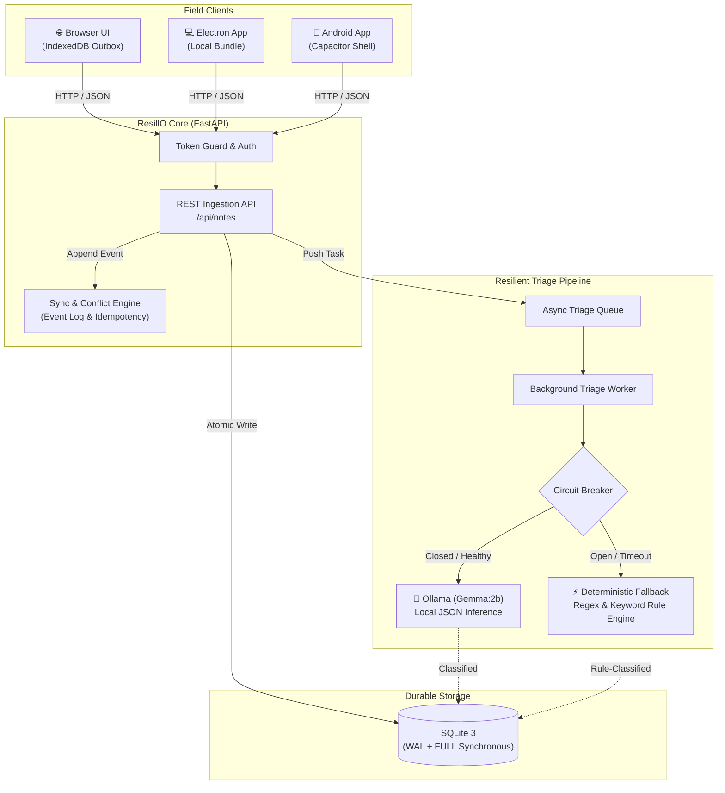

# 🛡️ ResillO

<p align="center">
  <strong>Mission-Critical, Offline-First Emergency Field Notes Triage Platform</strong>
</p>

<p align="center">
  <a href="#key-features"></a>
  <a href="#tech-stack"></a>
  <a href="#tech-stack"></a>
  <a href="#tech-stack"></a>
  <a href="#tech-stack"></a>
  <a href="#tech-stack"></a>
</p>

---

## 📌 Overview

**ResillO** is designed for first responders, humanitarian aid teams, and field operators navigating connectivity-dead zones, post-disaster areas, and hostile environments. 

It transforms unstructured, chaotic field notes into structured, actionable triage intelligence (Priority, Category, Location, Summary, and Immediate Needs) using **on-device, local open-weight AI (Gemma 2B via Ollama)**—ensuring **zero data ever leaves the local perimeter**.

> [!IMPORTANT]
> **Zero Data Loss Guarantee**: If local AI hangs, crashes, or is offline, ResillO’s **Circuit Breaker** instantly switches to an inline deterministic rule engine. Ingestion never blocks, and field reports are never lost.

---

## 🏗️ System Architecture



---

## ✨ Key Features

| Capability | Description |
|---|---|
| **🔒 Air-Gapped Intelligence** | Powered by local open-weight models (Gemma 2B via Ollama). Operates in complete radio silence with no external cloud dependencies. |
| **⚡ Multi-Tier Resilience** | Automatic 3-strike circuit breaker with cooldown isolation. Instant failover to keyword triage if Ollama stalls or crashes. |
| **🛡️ Crash-Durable Storage** | SQLite running with `WAL` (Write-Ahead Logging) and `FULL` synchronous disk flush guarantees zero database corruption on abrupt power loss. |
| **🔁 Idempotent Event Sourcing** | SHA-256 payload content hashing and UUID event sequencing prevents duplicate processing across intermittent mesh synchronizations. |
| **📲 Multi-Platform Support** | Unified dark-mode UI with native packaging for **Web**, **Electron Desktop**, and **Android (Capacitor)**. |

---

## 🚀 Quickstart (5 Minutes)

### 1. Start the Local AI Model
ResillO uses [Ollama](https://ollama.com) to run models locally on your CPU/GPU:

```bash
# 1. Pull the compact Gemma 2B model (~1.7 GB)
ollama pull gemma:2b

# 2. Verify model runs (type /bye to exit)
ollama run gemma:2b
```
> [!NOTE]
> Ensure Ollama is serving at `http://localhost:11434` (run `ollama serve` if not started as a system service).

---

### 2. Set Up the Python Backend

```bash
# Clone the repository
git clone https://github.com/your-org/resillo.git
cd resillo

# Create and activate virtual environment
python -m venv .venv

# On Linux/macOS:
source .venv/bin/activate
# On Windows (PowerShell):
.venv\Scripts\Activate.ps1

# Install dependencies
pip install -r requirements.txt
```

---

### 3. Launch ResillO

```bash
uvicorn main:app --reload --host 127.0.0.1 --port 8000
```
Open your browser at [http://127.0.0.1:8000](http://127.0.0.1:8000) to access the operator dashboard.

---

## 💻 Native Client Builds

### Electron Desktop App
The desktop application automatically bundles and manages the local backend process:

```bash
# Install Node dependencies
npm install

# Start the desktop application
npm run desktop
```

> [!TIP]
> If your Python virtual environment is in a non-default path, specify it via:
> ```powershell
> $env:RESILIO_PYTHON="D:\path\to\.venv\Scripts\python.exe"
> npm run desktop
> ```

### Android Mobile App (Capacitor)
The mobile client packages the field UI into an offline-ready APK:

```bash
# Initialize Android project (first-time only)
npm run android:add

# Sync assets and open in Android Studio
npm run android:sync
npm run android:open
```

* **Android Emulator:** Set the API Server URL in the app's settings dialog to `http://10.0.2.2:8000`.
* **Physical Device:** Connect over local Wi-Fi / ad-hoc network and set the server URL to your host machine's LAN IP (e.g. `http://192.168.1.50:8000`).

---

## ⚙️ Configuration Reference

All settings can be customized through environment variables or a local `.env` file:

| Environment Variable | Default | Purpose |
|---|---|---|
| `RESILIO_HOST` | `127.0.0.1` | Host interface to bind the API server |
| `RESILIO_PORT` | `8000` | Port for the API service |
| `RESILIO_DB_PATH` | `data/resillo.sqlite3` | File path for persistent SQLite database |
| `RESILIO_API_TOKEN` | *Auto-generated* | Secret token stored in `.token` file |
| `OLLAMA_URL` | `http://127.0.0.1:11434` | Ollama daemon endpoint |
| `OLLAMA_MODEL` | `gemma:2b` | Ollama model tag for inference |
| `OLLAMA_CONNECT_TIMEOUT` | `0.5` | Connection timeout in seconds |
| `OLLAMA_READ_TIMEOUT` | `2.0` | Read timeout before triggering circuit breaker |
| `RESILIO_MAX_PAYLOAD` | `65536` | Maximum allowed request payload size (bytes) |
| `CORS_ORIGINS` | *Localhost, Capacitor* | Allowed origins for cross-origin access |

---

## 📡 REST API Reference

ResillO provides a lightweight, token-secured REST API:

| Method | Endpoint | Description |
|---|---|---|
| `GET` | `/` | Web dashboard single-page interface |
| `GET` | `/api/health` | Diagnostics for DB, queue depth, and Ollama circuit status |
| `GET` | `/api/auth/token` | Retrieve local session authorization token |
| `POST` | `/api/notes` | Ingest and enqueue raw field note for triage |
| `GET` | `/api/notes` | Fetch all triaged notes (sorted newest first) |
| `POST` | `/api/notes/{id}/refresh` | Trigger threat re-evaluation & escalation counter |
| `POST` | `/api/notes/refresh-all` | Batch update assessment states across all active notes |
| `POST` | `/api/sync` | Reconcile peer-to-peer event logs with conflict resolution |

### Sample Ingestion Request

```bash
curl -X POST http://127.0.0.1:8000/api/notes \
  -H "Content-Type: application/json" \
  -H "X-Resillo-Token: <YOUR_TOKEN>" \
  -d '{
    "raw_text": "Sector 4 bridge collapsed. 3 casualties reported, urgent medical supplies and generator required.",
    "operator_id": "RESCUE-UNIT-07"
  }'
```

### Sample Triage Response

```json
{
  "id": "c3a504be-bfd2-43ce-9a3d-4c33c3e6cf50",
  "operator_id": "RESCUE-UNIT-07",
  "raw_text": "Sector 4 bridge collapsed. 3 casualties reported, urgent medical supplies and generator required.",
  "timestamp": "2026-11-16T17:00:00.000Z",
  "revision": 2,
  "triage_status": "complete",
  "priority": "CRITICAL",
  "category": "Infrastructure",
  "location": "Sector 4 bridge",
  "summary": "Sector 4 bridge collapsed with 3 casualties; medical supplies and generator urgently needed.",
  "actionable_needs": [
    "Medical supplies",
    "Power generator",
    "Search and rescue team"
  ],
  "threat_status": "MONITORED",
  "check_count": 1,
  "last_checked": "2026-11-16T17:00:01.000Z",
  "human_override": false
}
```

---

## 📂 Repository Structure

```
ResillO/
├── backend/                  # Core Python FastAPI backend
│   ├── api.py                # REST endpoints and authentication routes
│   ├── config.py             # Configuration defaults & token management
│   ├── db.py                 # SQLite WAL connection & schema setup
│   ├── sync_engine.py        # Event append log, SHA-256 idempotency & merge logic
│   ├── triage_engine.py      # Ollama client, CircuitBreaker & fallback rule engine
│   └── triage_worker.py      # Async background queue triage worker
├── desktop/                  # Electron desktop container
│   ├── main.cjs              # Electron main process & backend supervisor
│   └── preload.cjs           # Secure bridge & inter-process communication
├── android/                  # Capacitor Android native wrapper
├── tests/                    # Test suites
│   └── test_backend.py       # Triage, circuit breaker & idempotency tests
├── main.py                   # Server entrypoint & FastAPI lifespan hooks
├── index.html                # Responsive Tailwind CSS field dashboard
├── capacitor.config.ts       # Capacitor native bridge configuration
├── package.json              # Scripts for desktop & mobile toolchains
└── requirements.txt          # Python dependencies
```

---

## 🧪 Testing & Verification

Run the test suite to verify circuit breaker failover, idempotency, and conflict resolution:

```bash
pytest -v
```

---

<p align="center">
  Built for resilient crisis communications & emergency response 🕊️
</p>
